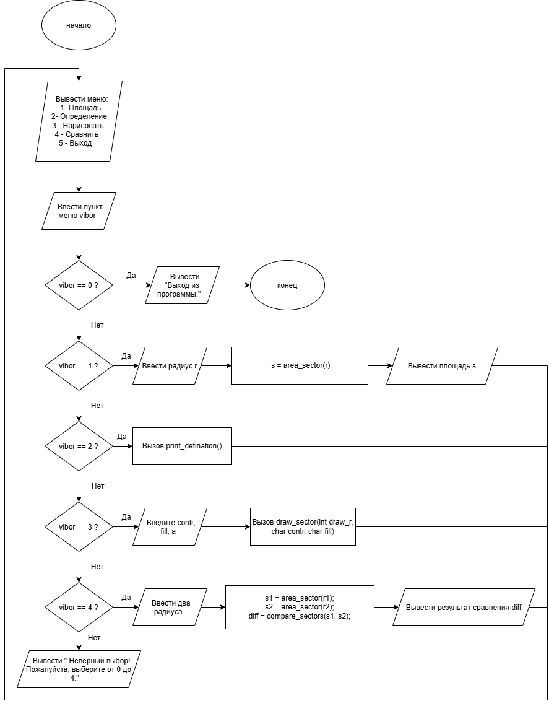

# Домашнее задание к работе 10

## Условие задачи

Составить программу, которая для заданной в ДЗ к лабораторной работе № 6 и ДЗ к лабораторной работе № 9 геометрической фигуры «Сектор круга» 

предлагает меню выбора одной из операций:

рассчитать площадь;
вывести определение фигуры;
нарисовать фигуру;
сравнить два треугольника по площади;
выход.
Для заданной фигуры реализовать отдельные функции:

double area_sector(double r) - вычисление площади сектора круга;

void print_definition(void) — вывод определения и геометрических свойств фигуры;

void draw_sector(int draw_r, char contr, char fill) — отрисовка сектора круга указанным символом;

double compare_sectors(double s1, double s2) — вычисление разности площадей двух секторов; 

---

## 1. Алгоритм и блок-схема

### Алгоритм

1. Настроить русскую локализацию для корректного вывода сообщений.
2. Организовать цикл do-while для циклического отображения меню и выбора пользователем необходимого действия.
3. Вывести пункты меню:
- 1 — рассчитать площадь фигуры;
- 2 — вывести определение фигуры;
- 3 — нарисовать фигуру;
- 4 — сравнить два сектора по площади;
- 0 — завершить работу программы.
4. Считать выбранный пункт vibor.
5. С помощью оператора switch выполнить выбранную ветвь:

Ветвь 1: запросить радиус r, проверить его корректность (r >= 0), вызвать функцию area_sector(r) и вывести площадь сектора.

Ветвь 2: вызвать функцию print_definition(), выводящую определение сектора круга.

Ветвь 3: запросить символы контура contr и закраски fill, а также радиус draw_r. Проверить условие (draw_r >= 2). При корректном значении вызвать функцию draw_sector(draw_r, contr, fill) для построения фигуры.

Ветвь 4: запросить радиусы двух секторов r1 и r2. Проверить их корректность, вычислить площади с помощью area_sector(), вызвать функцию compare_sectors(s1, s2) и вывести результат сравнения.

Ветвь 0: вывести сообщение о завершении программы.

6. Повторять цикл, пока пользователь не введёт пункт 0.

## Блок-схема

---

## 2. Реализация программы
---

## 3. Результаты работы программы

---

---

## 4. Информация о разработчике

- **ФИО:** Губский Данил Максимович
- **Группа:** бОТИ-261
